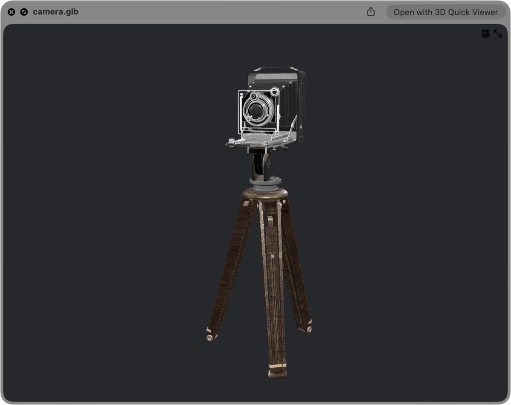

[日本語](https://github.com/magicien/MikuMikuDanceQuickLook/blob/master/lang/README.ja.md)

# MikuMikuDanceQuickLook
macOS QuickLook plugin for MikuMikuDance files

> [!IMPORTANT]
> **MikuMikuDanceQuickLook is no longer developed.** Its successor is **[3D Quick Viewer](https://apps.apple.com/app/id6804688390)** on the Mac App Store. [Details below](#moving-to-3d-quick-viewer).

## Moving to 3D Quick Viewer

Thank you to everyone who has used MikuMikuDanceQuickLook since 2017.

MikuMikuDanceQuickLook is a `.qlgenerator`, the older kind of Quick Look plugin. Apple introduced its replacement, Quick Look app extensions, in macOS 10.15, deprecated the old plugin API in macOS 12, and macOS 15 Sequoia no longer loads it at all. So I rebuilt MMD previews as a new app that uses the Quick Look extension mechanism Apple supports today.

### [3D Quick Viewer](https://apps.apple.com/app/id6804688390)

- **Same workflow:** select a file in Finder and press Space. Finder icons show thumbnails of the model too.
- **Simple install:** get it from the Mac App Store and open it once. No Terminal, no `qlmanage -r`.
- **Better MMD support:** .pmx / .pmd models with toon shading, sphere maps, edges, facial morphs and physics (hair and skirts sway while a motion plays). Motions (.vmd), poses (.vpd), whole MMD projects (.pmm) and accessories (.x) open too.
- **More formats:** glTF, VRM, FBX, USD, STL, OBJ, 3MF and others. 22 formats in total.
- **A viewer app as well:** an orbit camera, and an inspector that lists vertices, materials, bones and morphs.

It requires **macOS 15 or later**. It is a **paid app with a one-time purchase**. Sales pay for continued development, including support for new macOS versions.

### What happens to this repository

- The repository stays public, and the source code and past releases remain available.
- There will be no new releases, and issues and pull requests will no longer be handled.
- On Intel Macs with macOS 14 or earlier, the plugin keeps working as before. The instructions below are kept for those systems.

---

*Everything below is the original MikuMikuDanceQuickLook documentation, kept for macOS 14 and earlier.*

## System Requirements

- macOS 10.13 (High Sierra) to macOS 14 (Sonoma)
- Intel Mac. The release build contains Intel (x86_64) code only and has not been tested on Macs with Apple silicon.
- It does not work on macOS 15 (Sequoia) or later. Use [3D Quick Viewer](https://apps.apple.com/app/id6804688390) instead.

## Supported file formats

- .pmd (Polygon Model Data)
- .pmx (Polygon Model eXtended)
- .x (DirectX File)

## Install

### Manually

1. Download **MikuMikuDanceQuickLook_vX.X.X.zip** from [Releases](https://github.com/magicien/MikuMikuDanceQuickLook/releases/latest).
2. Put **MikuMikuDanceQuickLook.qlgenerator** (in the zip file) into `/Library/QuickLook` (for all users) or `~/Library/QuickLook` (only for the logged-in user).
3. Run `qlmanage -r` command to reload QuickLook plugins.

## Uninstall

When you switch to 3D Quick Viewer, you can remove the old plugin:

1. Delete **MikuMikuDanceQuickLook.qlgenerator** from `/Library/QuickLook` or `~/Library/QuickLook`.
2. Run `qlmanage -r` command to reload QuickLook plugins.

## See also

- [3D Quick Viewer](https://apps.apple.com/app/id6804688390) - The successor to this plugin. A 3D viewer with a Quick Look extension for MMD, VRM, glTF, FBX, USD, STL, OBJ and more.
- [MMDSceneKit](https://github.com/magicien/MMDSceneKit/)
